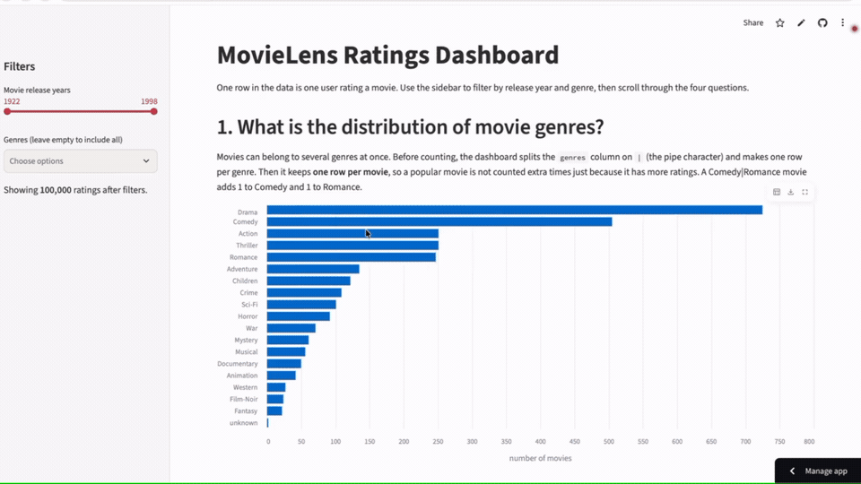

# 🎬 MovieLens Ratings Dashboard

An interactive dashboard built with Python and Streamlit to explore movie ratings using the MovieLens dataset. I created this project to practice data analysis, visualization, and building interactive applications. The dashboard makes it easier to explore movie ratings, compare genres, and identify trends through different charts and filters.

## 📦 Technologies

- `Python`
- `Pandas`
- `Streamlit`
- `Altair`

## 🦄 Features

Here's what you can explore with the MovieLens dashboard:

- **Interactive Filters:** Filter movies by genre and release year to explore different parts of the dataset.
- **Genre Distribution:** See how movies are distributed across different genres.
- **Release Year Trends:** Explore how the number of movie releases changes over time.
- **Movie Ratings:** Compare average movie ratings and the number of ratings each movie receives.
- **Top-Rated Movies:** View the five highest-rated movies using minimum rating thresholds of 50 and 150.
- **Data Visualizations:** Explore the dataset through interactive charts and tables.

## 👩🏽‍🍳 The Process

I started by exploring the MovieLens dataset to get a better understanding of the information I was working with. I used Pandas to organize the data and prepare it for analysis.

Next, I focused on identifying what information would be useful to display. I wanted users to be able to explore movie ratings, genres, and release years without having to look through the raw dataset.

After that, I used Streamlit to build the dashboard and Altair to create the visualizations. I added interactive filters so users could explore different genres and release year ranges.

I also worked on the top-rated movies section. Instead of only sorting movies by their average ratings, I included minimum rating counts of 50 and 150 to make comparisons more meaningful.

Finally, I focused on organizing the dashboard so the charts, filters, and tables were easy to navigate and understand.

## 📚 What I Learned

Working on this project helped me gain more experience with data analysis and building interactive dashboards.

### 🐼 Working with Pandas

I practiced organizing and manipulating data using Pandas. This included filtering datasets, grouping information, and calculating values needed for the visualizations.

### 📊 Data Visualization

I learned more about using Altair to create charts that communicate information clearly. I also gained a better understanding of how different visualizations can help identify patterns in data.

### 🎛️ Building with Streamlit

This project gave me the opportunity to work with Streamlit and learn how to turn Python code into an interactive web application.

### 🎬 Understanding Movie Ratings

One thing I learned was that average ratings don't always tell the full story. A movie with only a few ratings might have a higher average than a movie rated by hundreds of users. Adding minimum rating counts helped make those comparisons more useful.

### 📈 Overall Growth

This project helped me become more comfortable working with datasets and turning information into something interactive. It also gave me more practice thinking about how users interact with data and how to present information in a way that's easy to understand.

## 💭 How Can It Be Improved?

There are a few features I'd like to explore adding in the future:

- Add a search feature to find movies by title.
- Include more detailed information about individual movies.
- Add additional visualizations to explore user rating patterns.
- Allow users to compare multiple movies side by side.
- Improve the dashboard's layout and responsiveness.

## 🚦 Running the Project

To run this project locally:

1. Clone the repository to your computer.
2. Navigate to the project directory.
3. Install the required dependencies.
4. Make sure the MovieLens dataset files are available.
5. Run the Streamlit application:

```bash
streamlit run app.py
```

6. Open the local URL displayed in your terminal to view the dashboard.

## 🍿 Video



## 🚀 Try It Out!

Want to explore the dashboard yourself? You can try the live version here:

🎬 **[Try the MovieLens Dashboard](https://movielens-dashboard-8up77sphvxfz47w38vzhwf.streamlit.app/#movie-lens-ratings-dashboard)**
